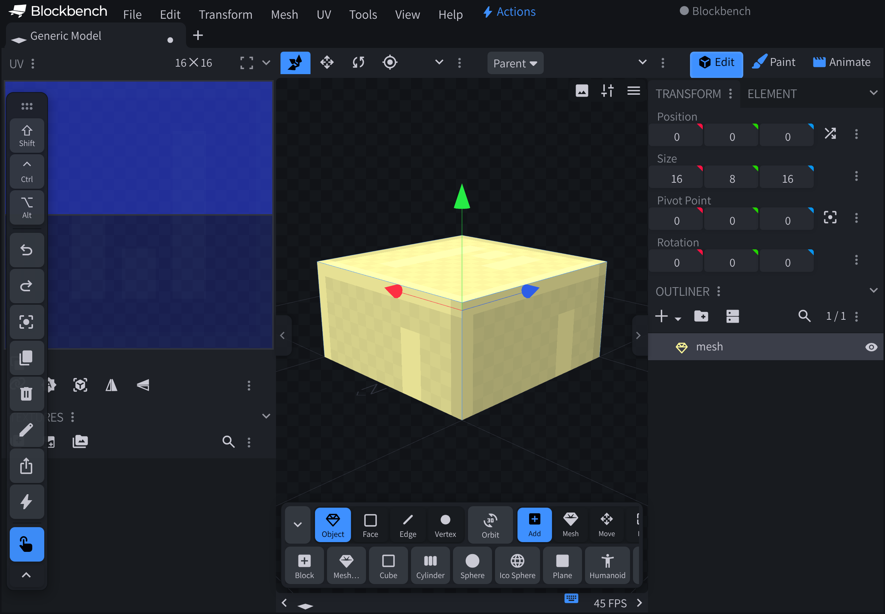
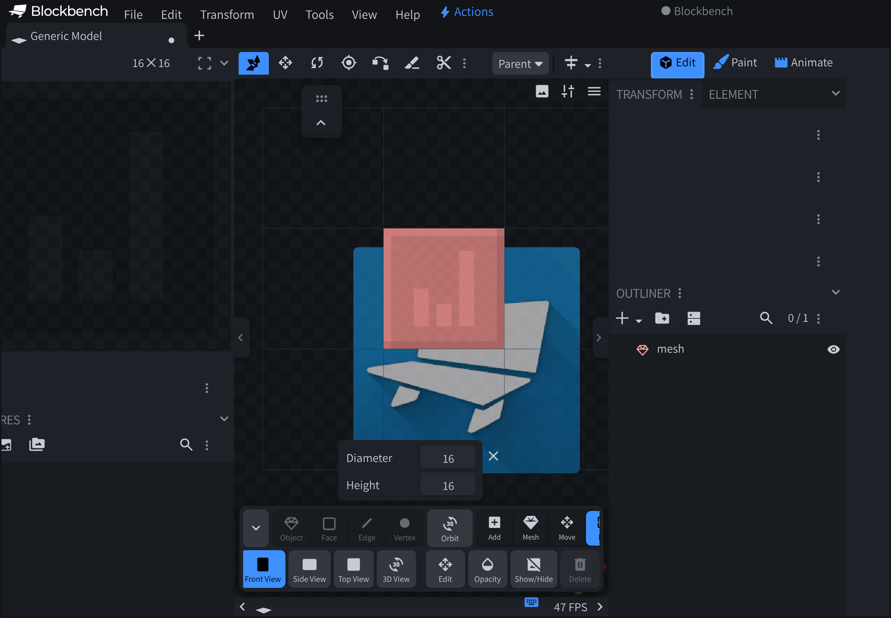
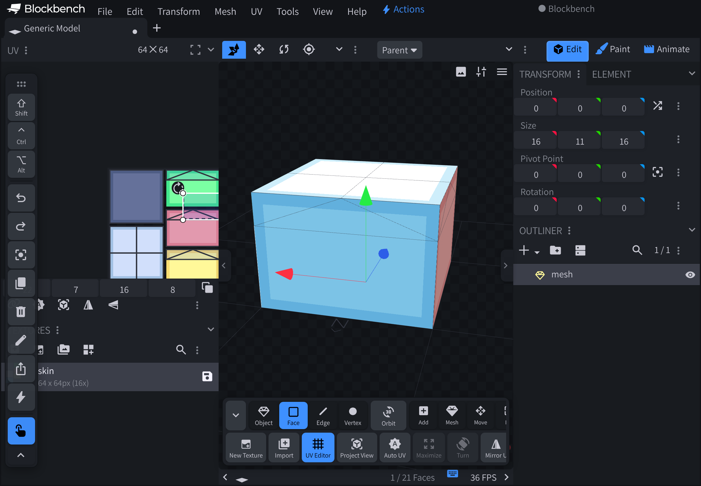
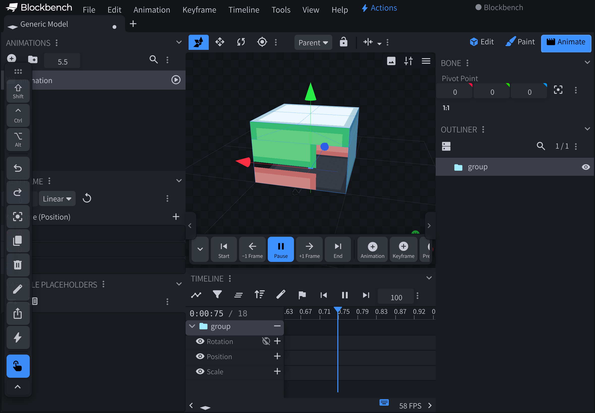
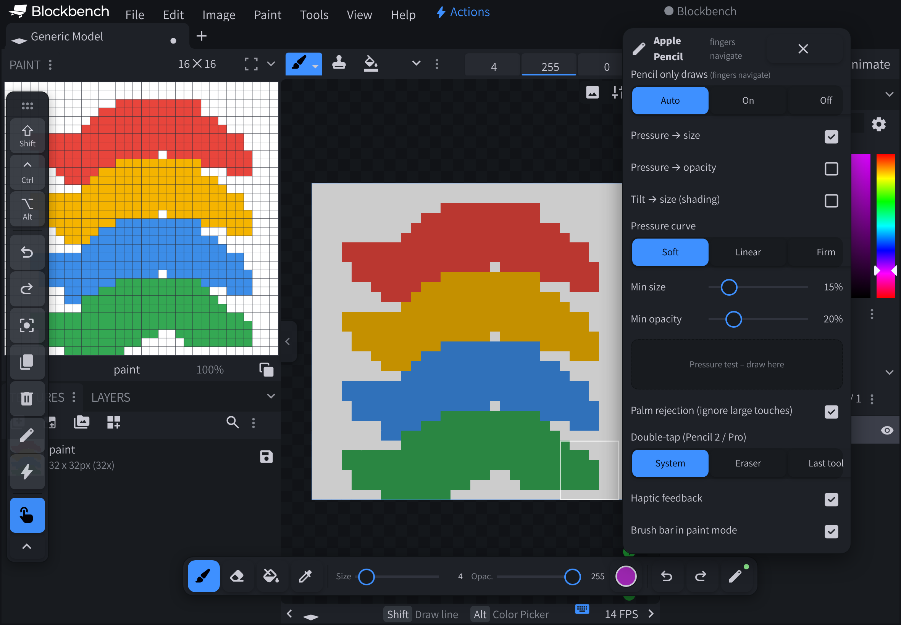
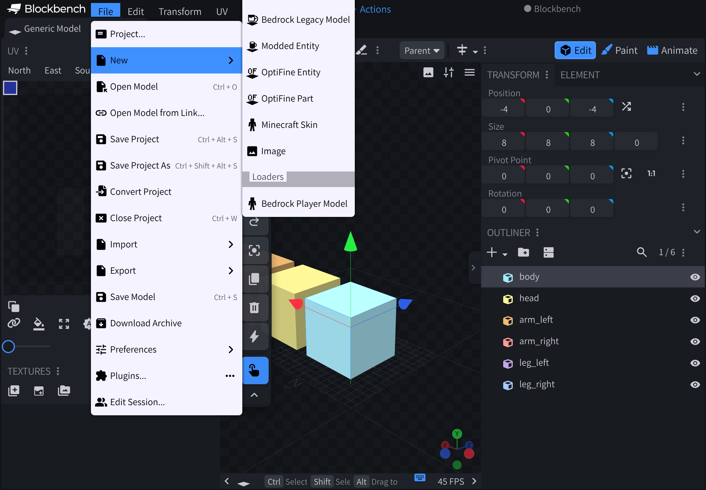
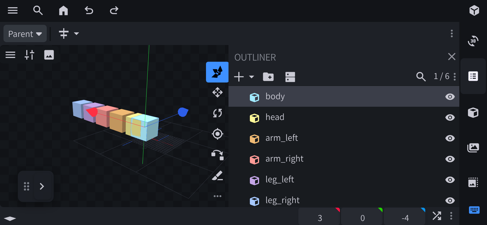
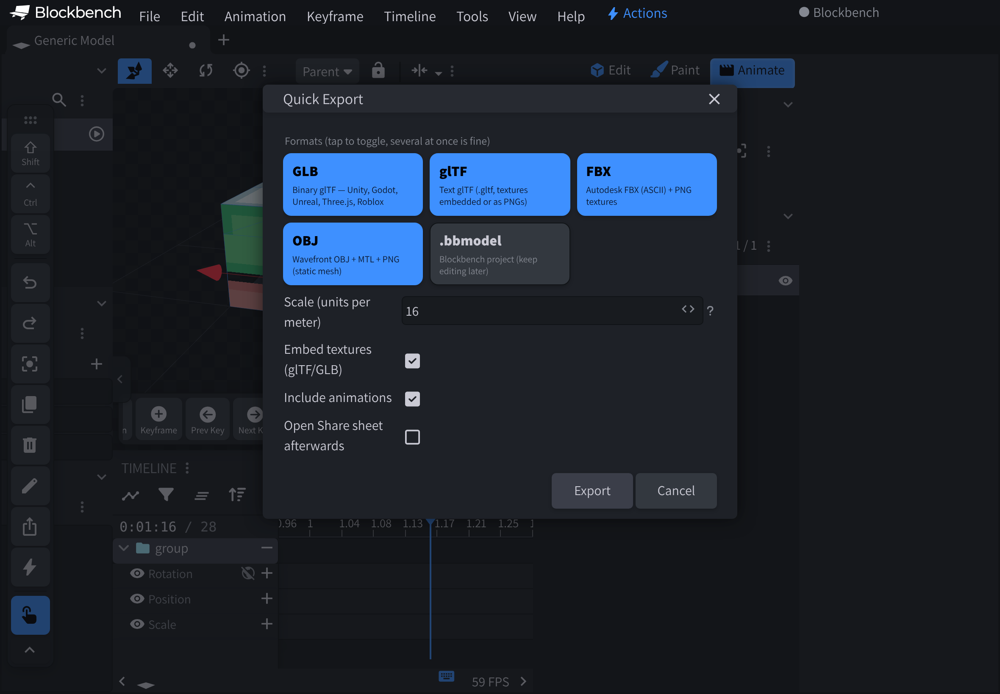
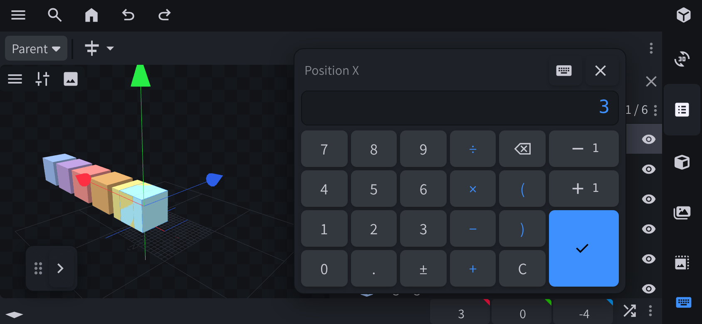
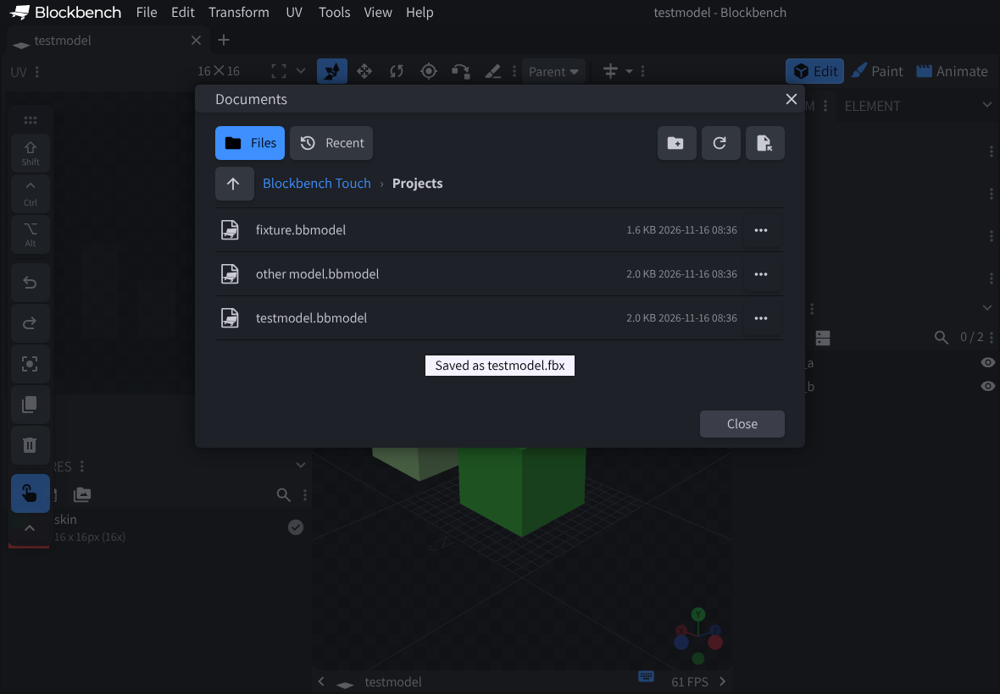

# Blockbench Touch

A **private, unofficial iOS / iPadOS port of [Blockbench](https://github.com/JannisX11/blockbench)** — the low-poly
3D model editor — with real touch, Apple Pencil and Files-app support. It is built as an unsigned IPA that you
sideload yourself. Main focus: the **Generic Model** format for game assets (mesh + cube modelling, UV/texturing,
animation, export to glTF / GLB / OBJ / FBX).

> **Not affiliated with Blockbench.** Blockbench is made by [JannisX11](https://github.com/JannisX11) and
> [contributors](https://github.com/JannisX11/blockbench/graphs/contributors) and is licensed under GPL-3.0.
> This port vendors upstream Blockbench 5.2.2 unchanged (see [`PATCHES.md`](PATCHES.md)) and adds a touch layer on top.
> It is licensed under the same **GPL-3.0** ([`LICENSE`](LICENSE)). Please report problems with this port here, not upstream.



## Features

- **Full Blockbench 5.2.2** (web build) running in a native app shell (Capacitor 8 / WKWebView), works **offline**.
- **Touch viewport**: orbit, pan, pinch-zoom, tap select, double-tap focus, long-press menus, 2-/3-finger undo/redo,
  bigger gizmo and easier picking.
- **Floating toolbar** with sticky **Shift / Ctrl / Alt**, undo/redo, focus, duplicate, delete, Pencil settings,
  Quick Actions, Quick Export. Vertical on iPad, horizontal (swipeable) on iPhone.
- **Generic Model workflow** ([illustrated guide](docs/GENERIC_MODEL_GUIDE.md)): start from Blockbench's own
  **Generic Model** entry, then the **Mesh Tools bar** (select modes, Box Select, add primitives + a rigged Humanoid
  base, extrude, inset, **subdivide**, loop cut, knife, merge, Move by…, UV tools…), **Animate bar**, timeline
  pinch-zoom, **Quick Export** to GLB / glTF / OBJ / FBX / .bbmodel in one tap.
- **Reference images / blueprints** (like Blender's background images): Mesh Tools › **Reference** › *+ Front / Right /
  Back / Left / Top* picks a character sheet or concept image (Photos, Camera or Files) and pins it behind the model in
  that orthographic view, half-transparent, so you can trace the shape. Pinch to resize, drag to move, **Done** to lock it
  behind the model; Front / Side / Top / 3D view buttons; opacity, show/hide, delete. Saved inside the .bbmodel.
- **Touch-friendly UI**: long press = right click everywhere, finger-sized menus/rows/buttons, number sliders you can
  scrub (with precision mode) or tap for a **keypad**, sidebar edge toggles, menus that behave on tap.
- **Apple Pencil**: pressure → brush size/opacity (with curves), tilt, palm rejection, *Pencil only draws* mode,
  coalesced 240 Hz strokes, brush bar with colour popover, Pencil double-tap (eraser / last tool / colours), haptics.
- **Files app**: projects in *On My iPad › Blockbench Touch* (Projects / Exports / Textures / Backups), save in place,
  Save As, multi-file exports into folders, share sheet, *Open in Blockbench Touch* from Files/Mail, automatic backups.
- **Privacy**: upstream telemetry, update checks and remote news are blocked (`touch/net.js`); only things you start
  yourself (plugin / theme store, sharing) go online.

| | | |
|---|---|---|
|  |  |  |
| Reference image (blueprint) | UV editor | Animate bar + timeline |
|  |  |  |
| Painting with the brush bar | Touch menus | iPhone (compact layout) |
|  |  |  |
| Quick Export | Number keypad | Documents browser |

## Touch cheat sheet

**3D viewport**

| Gesture | Does |
|---|---|
| 1 finger drag | orbit (or **box select** when the Mesh Tools bar is set to *Box Select*) |
| 1 finger drag on a gizmo arrow/ring | move / rotate / scale |
| 2 finger drag / pinch | pan / zoom (around the fingers) |
| tap | select element (or face / edge / vertex in those modes) |
| double tap | focus the tapped element · on empty space: frame everything |
| long press (~0.45 s) | context menu, opens while you hold |
| 2 finger tap / 3 finger tap | undo / redo |
| toolbar **Shift / Ctrl / Alt** | tap = applies to the next action, double tap = lock (tap again to release) |

Viewport modifiers: **Ctrl** = add/remove from selection, **Shift** = group select (multi-select for loose elements),
**Alt** = loop select (mesh edges). In the outliner **Shift** = range select.

**Everywhere else**

| Gesture | Does |
|---|---|
| long press | right click (context menu) — outliner, textures, UV editor, timeline, tabs, panels… |
| long press, then drag (outliner) | the menu closes and the item is re-ordered / re-parented |
| long press a toolbar button | shows its tooltip; keep holding for its context menu |
| number slider: drag sideways | scrub · hold first or move the finger far above/below = fine steps |
| number slider: tap | keypad (digits, maths, ± step); ⌨ switches to the iOS keyboard |
| sidebar edge tab (iPad) | hide / show the left or right sidebar |
| ⚡ Actions (menu bar / toolbar) | search every Blockbench action |
| timeline: 2 finger pinch / drag | zoom the time axis / scroll · drag the ruler = scrub |
| UV editor: pinch / 2 finger drag | zoom / pan |

**Apple Pencil & painting**

| Input | Does |
|---|---|
| Pencil | paints (paint tools) or acts as a precise mouse (select, gizmo) |
| Pencil pressure / tilt | brush size / opacity (curve + minimums in ✎ Pencil settings) |
| finger while *Pencil only draws* is on | navigates: 1 finger orbit (UV editor: pan), 2 fingers pan/zoom, 2-/3-finger tap undo/redo |
| second finger during a finger stroke | turns the stroke into navigation (a stroke < 0.45 s is reverted) |
| Pencil double tap (Pencil 2 / Pro) | system setting, or eraser / last tool / colour popover |
| palm on the screen | ignored while the Pencil is down, 300 ms after, and for large contact areas |

## Getting the IPA

1. Open the repository on GitHub → **Actions** → workflow **Build IPA**.
2. Pick the latest run with a green check (any branch you want to install) → scroll to **Artifacts** →
   download **`BlockbenchTouch-ipa`** (you must be logged in to GitHub). It is a zip containing `BlockbenchTouch.ipa`;
   unzip it.
3. Manual runs (**Run workflow** with *release* ticked) also publish the IPA as a GitHub **Release**
   (`v1.0.0-<run number>`), which is handy for AltStore/Sideloadly on the device itself.

The IPA is **unsigned**: a sideloading tool signs it with your Apple ID on install.

## Sideloading

- **AltStore** ([altstore.io](https://altstore.io)) — install AltServer on a Mac/PC, install AltStore on the device,
  then *My Apps › +* and pick the IPA. Works with a **free Apple ID**: apps expire after **7 days** and are refreshed by
  AltStore (device and computer on the same Wi-Fi, or AltStore's own background refresh); max **3 sideloaded apps**
  (AltStore counts as one) and 10 App IDs per week. A paid developer account gives 1-year signing.
- **Sideloadly** ([sideloadly.io](https://sideloadly.io)) — Mac/Windows: connect the device by USB, drop the IPA in,
  enter your Apple ID, *Start*. Same 7-day / 3-app limits with a free Apple ID; re-sideload (or use its auto-refresh)
  before it expires. Your projects survive re-installing as long as you don't delete the app.
- **TrollStore** — permanent install without re-signing, **only on the iOS versions it supports** (check the
  TrollStore project page for the current list; it does not work on newer iOS releases). Open the IPA with TrollStore.
- **Developer Mode (iOS / iPadOS 16+)**: after the first sideload, go to **Settings › Privacy & Security ›
  Developer Mode**, switch it on, restart and confirm. Also trust your Apple ID under **Settings › General ›
  VPN & Device Management** if iOS asks.

Requirements: iOS / iPadOS 15 or newer; iPad strongly recommended (iPhone works with a compact layout).

## Using it

- Start with the [Generic Model guide](docs/GENERIC_MODEL_GUIDE.md) (model → UV/texture → animate → export to Unity /
  Godot / Unreal / Roblox).
- Your files: *Files › On My iPad (iPhone) › Blockbench Touch* — `Projects/`, `Exports/`, `Textures/`, `Screenshots/`,
  `Backups/`, `Imported/`. *File › Browse Documents* opens them inside the app.
- Touch mode (gestures, bigger targets, toolbar) can be switched off with the hand button in the floating toolbar.

## Building it yourself

Needs Node 22+, and for the IPA a Mac with Xcode 16+ (CI uses Xcode 26.3).

```sh
npm ci                  # root: Capacitor
npm run build           # upstream web build (blockbench/, esbuild) + assemble www/ with the touch layer
npm run serve           # http://localhost:8080 — try it in a desktop browser (touch emulation in dev tools)
npm test                # headless Chromium E2E suites (needs Playwright: npm i --no-save playwright)
npm run build:fast      # after editing touch/* only
npm run sync            # build + npx cap sync ios
open ios/App/App.xcodeproj   # run on a device with your own team, or:
xcodebuild -project ios/App/App.xcodeproj -scheme App -configuration Release -sdk iphoneos \
  -destination 'generic/platform=iOS' -derivedDataPath build CODE_SIGNING_ALLOWED=NO build
mkdir Payload && cp -R build/Build/Products/Release-iphoneos/App.app Payload/ && zip -qry BlockbenchTouch.ipa Payload
```

Layout: `blockbench/` = upstream (git subtree, unmodified) · `touch/` = the touch layer (plain JS/CSS injected into
`www/index.html`) · `ios/` = Capacitor iOS project · `scripts/` = build + tests · `.github/workflows/build-ipa.yml` = CI.
Development notes per milestone are in [`PROGRESS.md`](PROGRESS.md); every upstream hook is listed in
[`PATCHES.md`](PATCHES.md). App icon / splash: `scripts/make-icons.sh` (ImageMagick).

## Updating Blockbench (upstream)

```sh
git subtree pull --prefix=blockbench https://github.com/JannisX11/blockbench.git master --squash
npm run build && npm test
```

Then go through the **runtime hooks** table in [`PATCHES.md`](PATCHES.md): every upstream function/field the touch
layer wraps or relies on is listed there with the file that uses it. Fix whatever the tests flag, update the version /
commit at the top of `PATCHES.md`, push, and let CI build a new IPA.

## Troubleshooting

| Problem | Try |
|---|---|
| "Unable to install" / app won't open | Enable Developer Mode (iOS 16+), trust the Apple ID profile, re-sideload. |
| App stops opening after a week | Free Apple ID signatures expire after 7 days — refresh in AltStore / re-sideload. Projects stay. |
| Gestures act like a mouse | Touch mode is off — tap the hand button in the floating toolbar. |
| Toolbar in the way | Drag it by its grip, or collapse it with the chevron. |
| Finger doesn't paint | *Pencil only draws* switched on after you used the Pencil — ✎ settings → Off / Auto. |
| Can't find exported files | Files › On My iPad › Blockbench Touch › Exports (multi-file exports are in sub-folders). |
| A file can't be picked | The picker shows all files; unsupported types are skipped with a message. |
| Lost work | Check `Backups/` (every 3 min with unsaved changes and when the app goes to the background). |
| Something odd in the UI | Connect the device to a Mac → Safari › Develop › *device* › Blockbench Touch for the web inspector. |
| Plugin / theme store empty | It needs internet; everything else works offline. |

## Credits

- [Blockbench](https://www.blockbench.net) by JannisX11 and contributors — GPL-3.0.
- [Capacitor](https://capacitorjs.com) by Ionic — MIT.
- Touch layer, iOS shell and docs of this port: GPL-3.0, like Blockbench.
