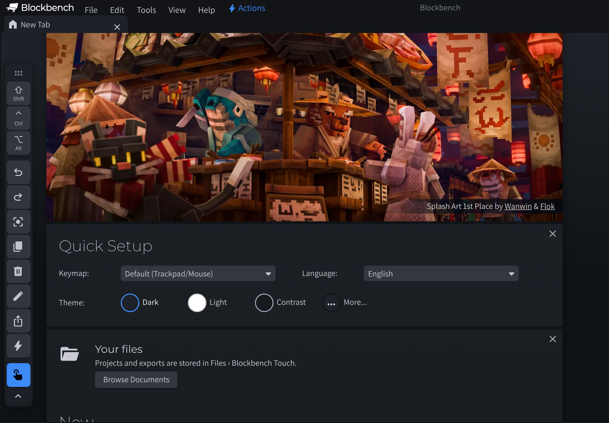
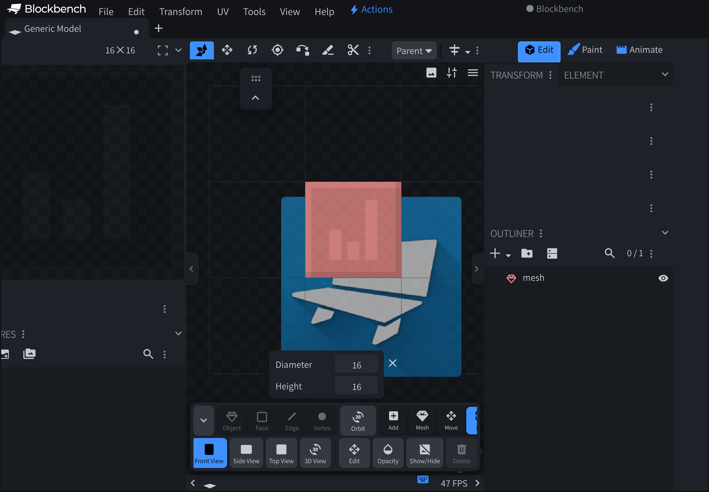
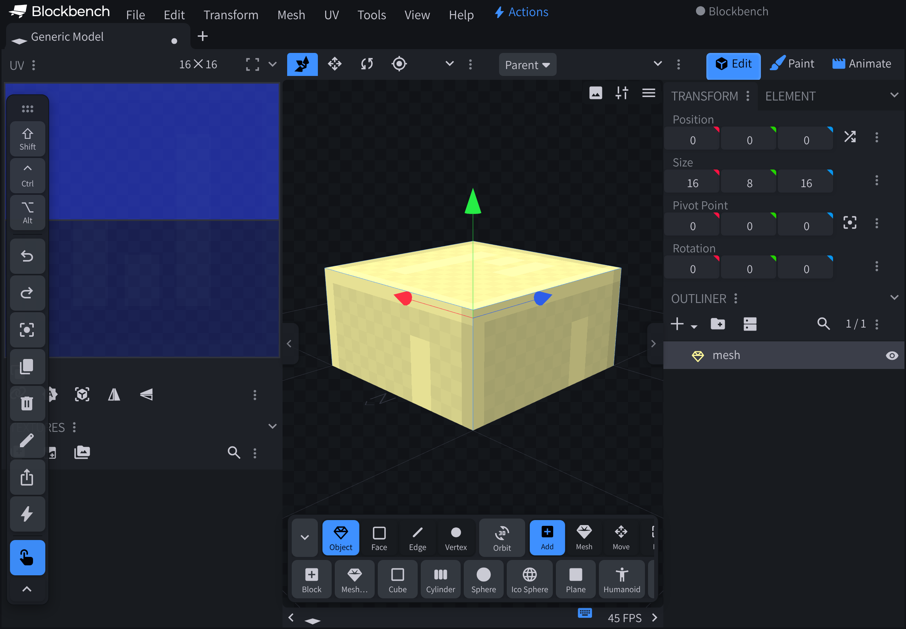
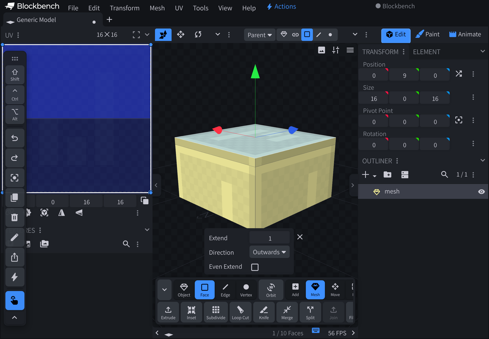
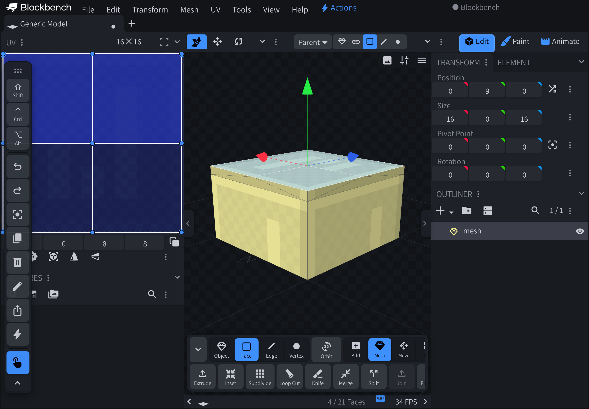
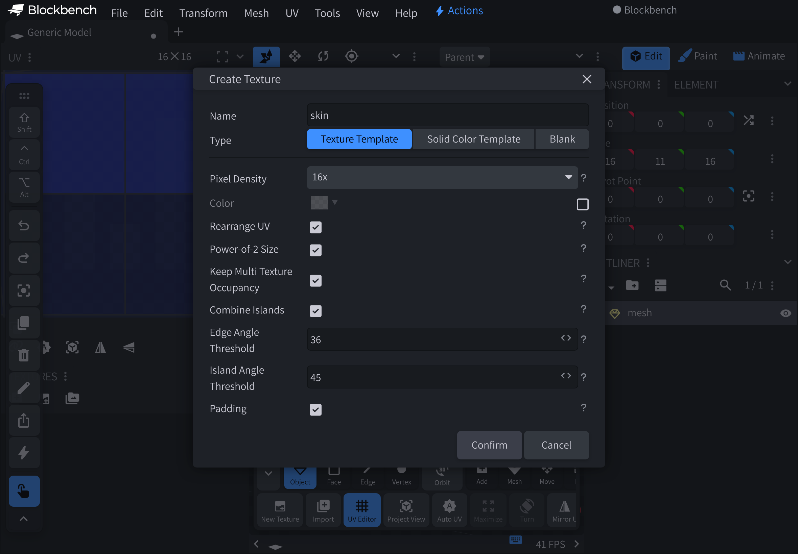
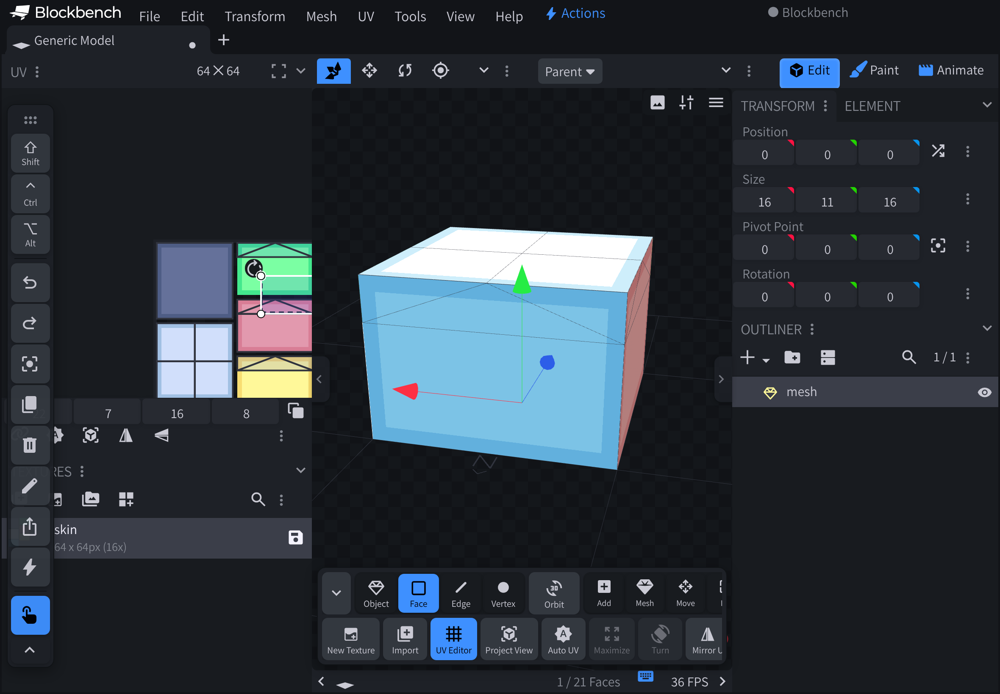
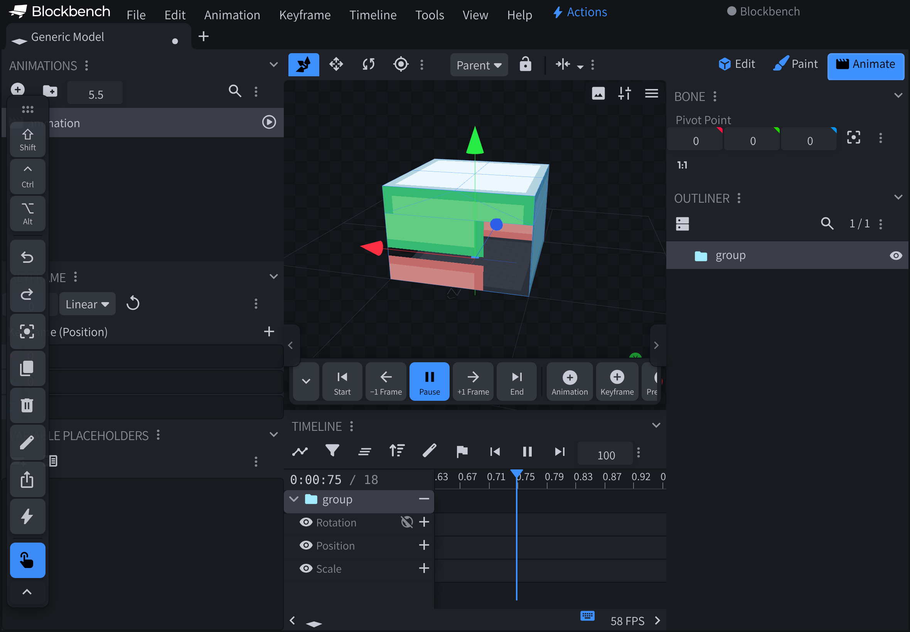
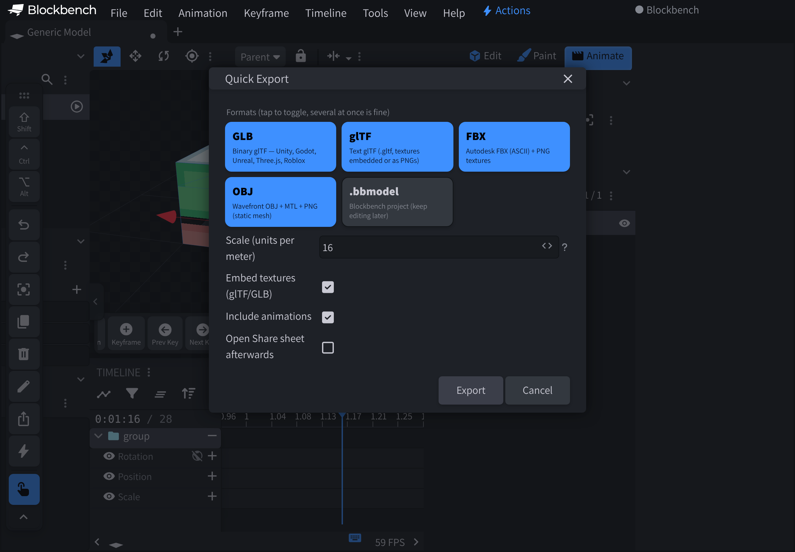

# Making a game asset on iPad / iPhone (Generic Model)

A start-to-finish walkthrough with touch gestures: model → UV/texture → animate → export to a game engine.

## Gestures cheat sheet (3D viewport)

| Gesture | Does |
|---|---|
| 1 finger drag | orbit (or **box select** when the Mesh Tools bar says *Box Select*) |
| 2 finger drag / pinch | pan / zoom |
| tap | select element, or face / edge / vertex in those modes |
| long press | context menu (opens while holding) |
| double tap | focus selection / frame everything |
| 2 / 3 finger tap | undo / redo |
| drag a gizmo arrow | move / rotate / scale the selection |
| floating toolbar **Shift** | next tap adds to the selection (double tap = lock) |

## 1. Start

On the start screen, tap **Generic Model** (Blockbench's own entry, under *General*), then **Create New Model**, and
confirm the *Project settings* (name, texture size). **File › New › Generic Model** does the same.

The Mesh Tools bar appears at the bottom. **Add › Humanoid** drops in a ready-to-animate base: six box meshes (body,
head, arms, legs), each in its own bone.

## 1b. Trace a character sheet (reference images)

Like Blender's background images: put a drawing behind the model and model on top of it.

1. Mesh Tools › **Ref** (Reference) › **+ Front**, **+ Right**, **+ Back**, **+ Left** or **+ Top**.
   The view switches to that side (orthographic) and the picker opens: choose Photo Library, Take Photo or Files.
2. The image is placed behind the model at 60 % opacity and is in edit mode:
   **drag** to move it, **pinch** (or the corner handles) to resize it so it lines up with the grid/model.
3. Tap **Done**. The image now sits behind the model and ignores touches, so orbit/pan/zoom work as usual. It only
   shows in the view it belongs to and follows that view's zoom, so it stays lined up.
4. Switch with **Front View / Side View / Top View / 3D View**. Add a side image too, then block out the shape in
   front and side views (Add › Cube, then Move/Scale, extrude in Face mode, Mirror modeling for symmetric characters).
5. **Opacity** fades the image, **Show/Hide** toggles all of them, **Edit → select → Delete** removes one.

"Front" is the side the model faces (Generic Model: −Z, same as the default camera). Reference images are saved in the
.bbmodel; they are never exported to GLB/OBJ/FBX.

## 2. Model

The **Mesh Tools bar** at the bottom of the viewport has two rows:

- **Row 1:** select mode **Object / Face / Edge / Vertex**, the **Orbit ⇄ Box Select** drag toggle, and the categories **Add / Mesh / Move / Ref / UV/Tex**.
- **Row 2:** large buttons for the chosen category. Swipe the row sideways to see more buttons.
- **Collapse:** the ⌄ button hides the bar.

Categories:

- **Add:** Block (a cube element), Mesh… (all 13 primitives), Cube, Cylinder, Sphere, Ico Sphere, Plane, Humanoid (rigged base), Bone (wraps the selection in a group), Group, Locator, To Mesh. After you add a primitive, change its size or number of sides in the panel that appears above the bar.
- **Mesh:** Extrude, Inset, **Subdivide**, Loop Cut, Knife, Merge, Split, Join, Fill Face, Flip Normals, Dissolve, Solidify, Crease. Greyed-out buttons need a selection first; tapping one tells you what to select.
- **Ref:** reference images / blueprints, see 1b.
- **Move:** Move/Rotate/Scale/Pivot tools, **Move by…** (type an exact X/Y/Z offset on the keypad), Mirror modeling, Soft selection, Vertex snap, Grid, Origin→Geometry, Flip, Apply rotation.

Typical loop:

1. Tap **Face**.
2. Tap a face. To add more faces, tap the toolbar's Shift first, then tap them.
3. Tap **Extrude**, then drag the gizmo arrow or type the distance in the panel.

To select many vertices or faces, switch the drag toggle to **Box Select** and drag a rectangle. Two fingers still pan and zoom.

 

For exact numbers, tap any value in the right panel to get the keypad, or drag sideways on it to scrub.

## 3. UV and texture

1. Open **UV/Tex › New Texture**, choose **Template**, and turn on *Rearrange UV*. This creates a texture and lays out the UV automatically.
2. Tap **UV Editor** to show it.
   - Pinch to zoom.
   - Drag with 1 finger on the background to pan.
   - Drag a face's UV with 1 finger to move it.
   - The bar also has Project from View, Auto UV, Maximize, Turn, Mirror, Merge/Connect UV and Snap to pixels.
3. Paint in **Paint** mode. Apple Pencil support is covered separately.

 

## 4. Animate

Animation targets bones, i.e. groups. Select the mesh, then use **Add › Bone**; Add › Humanoid already has bones. Next, tap the **Animate** tab (top right). The bar then switches to playback controls.

1. Tap **Animation** to create one.
2. Select the bone, move the playhead, and tap **Keyframe** to key its pose. Rotate the bone with the gizmo, then key again at another time.
3. Use the timeline:
   - Drag on the time ruler to scrub.
   - Pinch to zoom the time axis.
   - Drag with 2 fingers to scroll.
4. Use **Play/Pause**, **Start**, **±1 Frame** and **Loop**.
5. Tap **Graph** to open the curve editor.

## 5. Export for your engine

1. Open **File › Quick Export…**. The ⤴ button in the floating toolbar and the bar's **Export…** button open the same dialog.
2. Tap one or more formats.
3. Tap **Export**.

Files go to **Files › On My iPad › Blockbench Touch › Exports**. The summary dialog has **Share** (AirDrop, Save to Files…). Your choices are remembered.

| Format | Use for | Notes |
|---|---|---|
| **GLB** | Godot 4, Unity (glTFast / UnityGLTF), Unreal 5 (glTF importer / Interchange), Three.js / Babylon, Roblox (3D importer accepts .glb/.fbx/.obj) | One file, textures and animations embedded. **Recommended.** |
| glTF | Same as GLB, but as text you can read | With *Embed textures* off, PNGs go next to it in a folder |
| FBX | Unity, Unreal, Roblox, older pipelines | ASCII FBX plus PNG files in `Exports/<name>_fbx/` |
| OBJ | Static props, 3D printing, any tool | OBJ + MTL + PNG, no animation or bones |
| .bbmodel | Keep editing later | Saved to `Projects/` |

**Scale and axes**

- Blockbench measures in pixels, and 16 px = 1 block. Keep **Scale = 16** so that one block is 1 m in the engine. The Humanoid base is then 2 m tall.
- glTF is Y-up and right-handed, which matches Blockbench, so the model needs no rotation.
- Godot and Three.js import glTF exactly as it is.
- Unity converts glTF to its left-handed space automatically. For FBX, tick *Bake Axis Conversion* if the model comes in rotated.
- Unreal is Z-up and uses centimetres. Its glTF/FBX importers convert the axis. Set the import **uniform scale to 100** (or export with Scale = 0.16) when 1 block should be 1 m.
- Roblox Studio uses studs (about 0.28 m). Import the GLB/FBX and scale it in the importer. Rigs need bones; Roblox prefers FBX/GLB with a skinned armature, so check the *armature* option in the full glTF exporter (File › Export › glTF) if you need skinning.
- Textures are pixel art. Set the texture filter to **Point/Nearest** in your engine (Godot: Filter *Nearest*; Unity: Filter Mode *Point*; Unreal: Texture Group *2D Pixels*).
